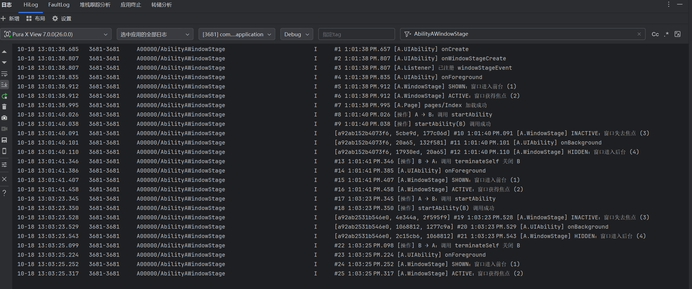

# Homework3：Ability A → B 与 WindowStage 事件记录

`EntryAbility` 是 A，新增的 `AbilityB` 是 B。A 使用 `UIAbilityContext.startAbility()` 启动 B；B 使用 `terminateSelf()` 关闭自身并返回 A。

## 运行与查看

1. 在 DevEco Studio 中选择设备或模拟器，运行 `entry`。
2. 在 DevEco Studio 的 HiLog 中按标签 `AbilityAWindowStage` 筛选输出。
3. 在 A 页面点击“跳转到 Ability B”，在 HiLog 中观察 A 的实际事件回调。
4. 在 B 页面点击“返回 Ability A”，在 HiLog 中查看返回产生的事件。

记录包括序号、毫秒时间、来源、事件名称和枚举值：

- `[A.WindowStage]`：通过 `windowStage.on('windowStageEvent', callback)` 收到的真实事件，覆盖 `SHOWN`、`ACTIVE`、`INACTIVE`、`HIDDEN`、`RESUMED`、`PAUSED`。
- `[A.UIAbility]`：A 的 Ability 生命周期回调，用来与 WindowStage 事件对照。
- `[操作]`：跳转、返回操作及调用结果；调用成功不代表窗口动画或事件回调已经全部完成。

监听在 A 的 `onWindowStageCreate` 中、加载页面前注册，在 `onWindowStageDestroy` 中使用同一回调注销。A 进入后台时继续保留监听。

全屏跳转时可重点观察 A 的失焦、不可交互、进入后台等事件；返回时观察进入前台、可交互、获焦等事件。这里不预设事件序列：`windowStageEvent` 不保证各类事件之间的顺序，实际事件及顺序以当前设备回调为准，分屏等场景可能不同。参见 [华为窗口生命周期文档](https://developer.huawei.com/consumer/cn/doc/doccenter-capabilities/window-lifecycle)。

日志仅输出到 HiLog，界面不显示日志，也不通过 AppStorage 缓存记录。

## 验证情况

已使用本机 DevEco Studio 工具链完成 `entry@default` 的 debug `assembleHap` 构建，ArkTS 编译与 HAP 打包通过。该次构建未配置签名，生成的是未签名 HAP。随附的运行录屏和 HiLog 截图见下方。

## 演示材料

- [运行录屏](media/ability-navigation.mp4)
- [WindowStage 事件日志截图](media/windowstage-events.png)

## 主要文件

- `entry/src/main/ets/entryability/EntryAbility.ets`：A 的 WindowStage 监听和生命周期日志。
- `entry/src/main/ets/abilityb/AbilityB.ets`：B 的 UIAbility。
- `entry/src/main/ets/pages/Index.ets`：启动 B。
- `entry/src/main/ets/pages/AbilityBPage.ets`：关闭 B 并返回 A。
- `entry/src/main/ets/common/AbilityEventLog.ets`：统一记录和 HiLog 输出。
